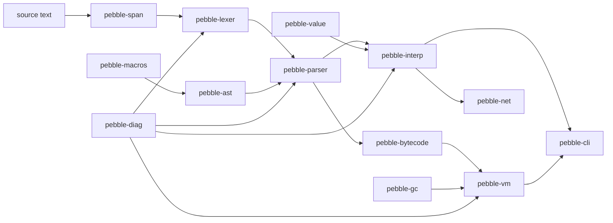

# Pebble architecture

Pebble is a small dynamically typed scripting language implemented as a Cargo
workspace. The point of the project is that every crate exists to make a
different corner of Rust do real work, so the *shape* of the workspace is the
interesting part.

## Data flow

There are **two independent backends**:

* `pebble-interp` walks the AST with `Rc<RefCell<..>>` environments.
* `pebble-vm` executes bytecode produced by `pebble-bytecode`, allocating its
  runtime objects on `pebble-gc`.

Both must agree on observable behaviour. Two rules keep them in sync:

1. Only *expression statements* carry a value; control-flow statements produce
   `nil`.
2. The value of a program (or of a function without an explicit `return`) is the
   value of the final expression statement.

They do not agree on everything. A `let` inside a block gets its own scope in
the tree-walker (each block has a child environment) but not in the VM (one
environment per call), and a list containing strings renders them quoted in
one backend and unquoted in the other. `crates/pebble-bench/tests/differential.rs`
holds the programs on which the two are known to agree.

## Crate responsibilities

| crate             | Rust features it exercises                                             |
| ----------------- | ---------------------------------------------------------------------- |
| `pebble-span`     | `#![no_std]`, `Copy`, newtypes, binary search, byte offsets            |
| `pebble-diag`     | error types, `Display`/`Error`, rendering, trait objects in sinks      |
| `pebble-lexer`    | zero-copy `&str` scanning, lifetimes, `Cow`, `Iterator`                |
| `pebble-ast`      | recursive enums, `Box`, visitor trait with defaults                    |
| `pebble-macros`   | `proc-macro` crate, `syn`/`quote`, derive + function-like macros       |
| `pebble-parser`   | recursive descent, Pratt parsing, `Result`/`?`, error recovery         |
| `pebble-value`    | `Rc`/`RefCell`, interior mutability, custom `Hash`/`Eq`, builtins      |
| `pebble-interp`   | environments, closures, control flow as data, recursion limits         |
| `pebble-bytecode` | instruction stream, jump backpatching, constant pool, disassembly      |
| `pebble-gc`       | `unsafe`, raw pointers, `MaybeUninit`, `Cell`, a generic mark-sweep GC |
| `pebble-vm`       | stack machine, opcode dispatch, GC roots, rooting discipline           |
| `pebble-sys`      | `build.rs`, `cc`, `extern "C"`, `repr(C)`, callbacks across FFI        |
| `pebble-nostd`    | `no_std` + `alloc`, `GlobalAlloc`, a bump allocator                     |
| `pebble-net`      | `async`/`await`, Tokio, `spawn_blocking`, `Send`-safe design           |
| `pebble-cli`      | `clap`, `io`, an interactive REPL                                      |

## Design decisions worth knowing

**Names are resolved at run time.** The VM stores bindings in heap environments
and looks them up by name through the scope chain. This makes closures trivial
(a closure captures the current environment) at the cost of speed. A production
compiler would resolve locals to stack slots and add upvalue capture; that is
the natural next optimisation and is left as an exercise.

**The tree-walker leaks; the VM does not.** A recursive `fn` defined in the
environment it captures forms an `Rc` cycle, so the tree-walking backend leaks
that memory. The VM allocates the same structure on `pebble-gc`, so the
collector reclaims it. This difference is deliberate and is the reason both
backends exist.

**Diagnostics are data.** Nothing prints inside the lexer, parser, or
interpreter. They return `Diagnostic`/`RuntimeError` values, and only the CLI
renders them. That is what makes the "report every error, not just the first"
behaviour possible.

**`no_std` where it is free.** `pebble-span`, `pebble-diag`, and `pebble-lexer`
only need `core` + `alloc`, so they are `#![no_std]` and reuse the same code on
bare metal (`pebble-nostd`).

## Adding a language feature

1. Add the token in `pebble-lexer` and cover it with a test.
2. Add the AST node in `pebble-ast` (derive `Spanned`, extend the `walk_*`
   functions).
3. Parse it in `pebble-parser` (and add a recovery path).
4. Interpret it in `pebble-interp`.
5. Compile it in `pebble-bytecode` (new opcode via `opcode_set!` if needed) and
   execute it in `pebble-vm`.
6. Add a test to both backends proving they agree.

## Testing strategy

* Unit tests live next to the code and cover behaviour, boundaries, and error
  paths.
* `pebble-cli/tests/` runs the built binary through `assert_cmd`.
* `pebble-bench` measures both backends with Criterion.
* `cargo clippy -- -D warnings` and `cargo fmt --check` gate CI.
